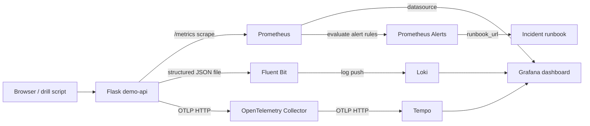

# Architecture — DevOps Capstone 2

## What we built
A small Flask HTTP API with intentionally controllable success, slow-response, and failure routes. The application exports three observability signals.

## Components and ports
| Component | Purpose | Local URL |
|---|---|---|
| Flask demo-api | Service and test failures | http://localhost:8000 |
| Prometheus | Pull metrics, evaluate alerts | http://localhost:9090 |
| Grafana | Dashboard and Explore | http://localhost:3000 |
| Loki | Store searchable JSON logs | http://localhost:3100 |
| Tempo | Store OpenTelemetry request traces | http://localhost:3200 |
| Fluent Bit | Read app logs, send to Loki | internal Docker network |
| OTel Collector | Receive and forward traces | internal Docker network |

## Data model and choices
- **Metrics:** `http_requests_total{method,route,status}` and `http_request_duration_seconds{method,route}`. Avoid path IDs to control cardinality.
- **Logs:** one JSON object per line, with `service`, `level`, `trace_id`, `route`, `status`, and `duration_ms`. Fluent Bit adds indexed Loki labels `service` and `level`.
- **Traces:** a root server span for each observed request and an extra nested span for simulated work. The trace ID is returned in the `X-Trace-ID` HTTP header and included in JSON logs.
- **Alerting:** Prometheus evaluates high 5xx rates every 5 seconds. Each alert contains a runbook link.
- **Dashboard as code:** Grafana starts with data sources and `capstone2.json` pre-provisioned, without manual import.

## Security and limitations
This is a **local capstone demonstration** rather than production infrastructure. Grafana has a demo password; loopback-only published ports, no TLS, short retention, and no remote alert receiver. The `/api/fail` endpoint deliberately creates an outage and must not be available on a public production service. Docker Compose is used instead of Kubernetes/Terraform/Helm to keep the demonstration reproducible in under an hour. No Kubernetes deployment is claimed.
